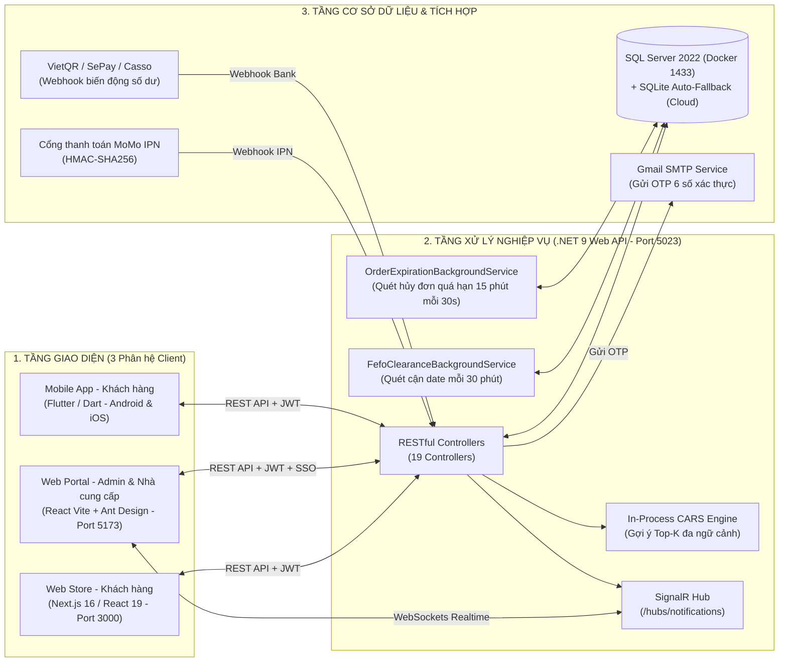
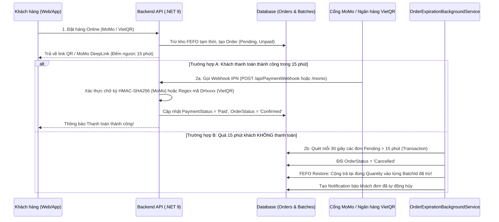
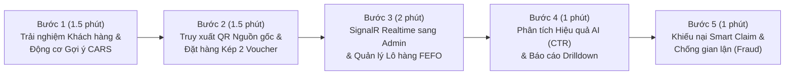

# 🎓 CẨM NANG ÔN TẬP & BẢO VỆ KHÓA LUẬN TỐT NGHIỆP
**Đề tài:** Hệ thống Thương mại Điện tử Nông sản Sạch (LÀNH Farm) tích hợp Truy xuất nguồn gốc Chuỗi cung ứng (FEFO) và Động cơ Gợi ý Top-K Đa ngữ cảnh (CARS)

---

## 1. TỔNG QUAN KIẾN TRÚC HỆ THỐNG & CÔNG NGHỆ

> [!IMPORTANT]
> Khi Hội đồng hỏi **"Hệ thống của em gồm những phân hệ nào và giao tiếp với nhau ra sao?"**, hãy trả lời theo đúng 4 thành phần thực tế đang chạy trong source code:



| Phân hệ | Công nghệ sử dụng | Vị trí mã nguồn chính | Vai trò cốt lõi |
| :--- | :--- | :--- | :--- |
| **Backend API** | C# .NET 9, EF Core 9, SignalR, JWT, BCrypt | [`backend/Ecc.WebApi/Program.cs`](file:///C:/123/KhoaLuanCuNhan/backend/Ecc.WebApi/Program.cs) | Xử lý toàn bộ nghiệp vụ, ACID Transaction, FEFO, CARS, Webhook thanh toán và chạy ngầm. |
| **Web Store** | Next.js 16 (App Router), React 19, TailwindCSS | [`web-store/src/app/`](file:///C:/123/KhoaLuanCuNhan/web-store/src/app) | Giao diện người tiêu dùng mua nông sản lẻ, đặt gói Combo định kỳ, quét mã truy xuất QR, khiếu nại Smart Claim. |
| **Web Portal** | React 19, Vite 8, Ant Design 6, Recharts/ECharts | [`web-portal/src/pages/`](file:///C:/123/KhoaLuanCuNhan/web-portal/src/pages) | Cổng quản trị hợp nhất (RBAC) cho cả **Admin** (toàn sàn) và **Nhà cung cấp / HTX** (`RoleId = 2`). |
| **Mobile App** | Flutter (Dart), Provider/SharedPreferences | [`mobile-app/lib/`](file:///C:/123/KhoaLuanCuNhan/mobile-app/lib) | Ứng dụng di động mua sắm, quét QR camera truy xuất nhật ký canh tác, thanh toán QR/MoMo. |
| **Cơ sở dữ liệu** | SQL Server 2022 (Docker) + SQLite Cloud (`21 bảng`) | [`backend/Ecc.Infrastructure/Data/AppDbContext.cs`](file:///C:/123/KhoaLuanCuNhan/backend/Ecc.Infrastructure/Data/AppDbContext.cs) | Lưu trữ 21 thực thể: `Users`, `Suppliers`, `Farms`, `Certificates`, `Products`, `ProductBatches`, `ProductSeasons`, `Orders`, `OrderItems`, `UserBehaviors`, `RecommendationLogs`... |

---

## 2. PHÂN TÍCH CHI TIẾT 8 LUỒNG XỬ LÝ NGHIỆP VỤ CỐT LÕI

### Luồng 1: Xác thực Đa vai trò (RBAC), OTP Email Thực tế & Cross-Origin SSO
- **File xử lý chính:** [`AuthController.cs`](file:///C:/123/KhoaLuanCuNhan/backend/Ecc.WebApi/Controllers/Common/AuthController.cs), [`OtpService.cs`](file:///C:/123/KhoaLuanCuNhan/backend/Ecc.Infrastructure/Services/OtpService.cs), [`JwtService.cs`](file:///C:/123/KhoaLuanCuNhan/backend/Ecc.WebApi/Services/JwtService.cs)
- **Các bước xử lý trong code:**
  1. **Kiểm tra trùng lặp (`POST /api/auth/check-unique`):** Kiểm tra Regex định dạng Email, SĐT 10 số bắt đầu bằng `0` (hoặc chuẩn hóa `+84` về `0`), và kiểm tra trùng tên Hợp tác xã trong bảng `Suppliers` ([`AuthController.cs#L202-L250`](file:///C:/123/KhoaLuanCuNhan/backend/Ecc.WebApi/Controllers/Common/AuthController.cs#L202-L250)).
  2. **Sinh & gửi mã OTP 6 số (`POST /api/auth/send-register-otp`):** Gửi mã OTP thực tế qua SMTP Gmail (`smtp.gmail.com:587`) với hiệu lực lưu tạm trên bộ nhớ để xác thực email chính chủ trước khi tạo tài khoản.
  3. **Phân quyền 3 vai trò (`RoleId`) & Kiểm duyệt Đối tác:**
     - `RoleId = 1` (`ADMIN`): Toàn quyền quản trị sàn.
     - `RoleId = 2` (`SUPPLIER` - Hợp tác xã/Nhà cung cấp): Khi mới đăng ký có trạng thái `Status = "Pending"`. Nếu chưa được Admin duyệt mà cố đăng nhập, hàm `Login` ([`AuthController.cs#L51-L68`](file:///C:/123/KhoaLuanCuNhan/backend/Ecc.WebApi/Controllers/Common/AuthController.cs#L51-L68)) sẽ chặn lại và thông báo hồ sơ đang chờ duyệt hoặc bị từ chối (`Rejected`).
     - `RoleId = 3` (`CUSTOMER` - Khách hàng): Kích hoạt ngay (`Active`).
  4. **Bảo mật mật khẩu & Cấp phát cặp Token:**
     - Mật khẩu được băm bằng thuật toán **BCrypt** (`BCrypt.Net.BCrypt.Verify` & `HashPassword`).
     - Khi đăng nhập thành công, hệ thống trả về **JWT Access Token** (hạn 60 phút, chứa `UserId`, `Role`, `SupplierId`, `FarmId`) kèm **Refresh Token** (hạn 7 ngày, lưu trong bảng `RefreshTokens` có cờ `IsRevoked` chống dùng lại token cũ).
  5. **Chuyển hướng SSO liên miền (Cross-Origin SSO):** Nếu người dùng đăng nhập tài khoản `ADMIN` hoặc `SUPPLIER` tại trang Web Store (`3000`), hệ thống tự động chuyển hướng sang Web Portal (`5173`) kèm tham số `?sso_token=...&sso_user=...` và tự động đồng bộ vào `localStorage` của trang Quản trị ([`web-portal/src/App.tsx#L68-L76`](file:///C:/123/KhoaLuanCuNhan/web-portal/src/App.tsx#L68-L76)).

---

### Luồng 2: Quản lý Lô hàng Nông sản, Truy xuất Nguồn gốc QR & Tự động Xả kho FEFO (FEFO Auto-Pilot)
- **File xử lý chính:** [`ProductBatchesController.cs`](file:///C:/123/KhoaLuanCuNhan/backend/Ecc.WebApi/Controllers/Web/ProductBatchesController.cs), [`FefoClearanceBackgroundService.cs`](file:///C:/123/KhoaLuanCuNhan/backend/Ecc.WebApi/Services/FefoClearanceBackgroundService.cs), [`CertificatesController.cs`](file:///C:/123/KhoaLuanCuNhan/backend/Ecc.WebApi/Controllers/Web/CertificatesController.cs)
- **Nguyên lý FEFO (First Expired, First Out - Hết hạn trước xuất trước):**
  - Khác với hàng công nghiệp dùng FIFO (Nhập trước xuất trước), nông sản tươi sống bắt buộc quản lý theo từng **Lô thu hoạch (`ProductBatch`)** gắn với **Nông trại (`Farm`)** và **Chứng nhận (`Certificate` - VietGAP/GlobalGAP)**.
- **Các quy tắc nghiệp vụ trong code:**
  1. **Ràng buộc nhập lô (`POST /api/productbatches`):**
     - Bắt buộc `ExpiryDate > HarvestDate` (Hạn sử dụng phải sau ngày thu hoạch ít nhất 1 ngày - [`ProductBatchesController.cs#L101-L104`](file:///C:/123/KhoaLuanCuNhan/backend/Ecc.WebApi/Controllers/Web/ProductBatchesController.cs#L101-L104)).
     - Tự động sinh mã lô chuẩn `LHN-yyyyMMdd-xxxx` nếu bỏ trống và kiểm tra chống trùng mã lô.
  2. **Phân loại 4 mức độ hạn sử dụng (`GET /api/productbatches/fefo-summary`):**
     - `Expired` (Đã hết hạn): `diffDays < 0` hoặc `Status == "Expired"`
     - `Urgent` (Cảnh báo đỏ khẩn cấp): `0 <= diffDays <= 3 ngày`
     - `Warning` (Cảnh báo vàng cận hạn): `4 <= diffDays <= 5 ngày`
     - `Safe` (An toàn): `diffDays > 5 ngày`
  3. **Dịch vụ chạy ngầm Tự động giảm giá xả kho (`FefoClearanceBackgroundService`):**
     - Chạy tự động mỗi **30 phút/lần** ([`FefoClearanceBackgroundService.cs#L51-L144`](file:///C:/123/KhoaLuanCuNhan/backend/Ecc.WebApi/Services/FefoClearanceBackgroundService.cs#L51-L144)):
     - **Bước 1:** Tự động khóa toàn bộ các lô đã qua ngày hết hạn (`ExpiryDate < today` $\rightarrow$ `Status = "Expired"`).
     - **Bước 2:** Tìm lô hàng còn tồn kho có hạn sử dụng gần nhất (`OrderBy(b => b.ExpiryDate).First()`). Nếu `0 <= diffDays <= 5`, hệ thống tự động lưu giá gốc vào `OriginalPrice` và áp dụng thang giảm giá luỹ tiến:
       - Còn **$\le 1$ ngày**: Tự động giảm **$50\%$**
       - Còn **$2$ ngày**: Tự động giảm **$40\%$**
       - Còn **$3$ ngày**: Tự động giảm **$30\%$**
       - Còn **$4 - 5$ ngày**: Tự động giảm **$20\%$**
     - **Bước 3 (Tự phục hồi giá gốc):** Khi lô cận hạn đã bán hết và lô tiếp theo của sản phẩm còn hạn $> 5$ ngày (`diffDays > 5`), hệ thống **tự động khôi phục `Price = OriginalPrice` và `DiscountPercent = 0`** ([`FefoClearanceBackgroundService.cs#L131-L138`](file:///C:/123/KhoaLuanCuNhan/backend/Ecc.WebApi/Services/FefoClearanceBackgroundService.cs#L131-L138)).

---

### Luồng 3: Đặt hàng ACID Transaction, Trừ tồn kho đa lô FEFO & Áp dụng Kép 2 tầng Voucher
- **File xử lý chính:** [`OrdersController.cs#L575-L1100`](file:///C:/123/KhoaLuanCuNhan/backend/Ecc.WebApi/Controllers/Web/OrdersController.cs#L575-L1100)
- **Tại sao luồng đặt hàng này rất ăn điểm khi bảo vệ?**
  1. **Sử dụng Database Transaction mức cô lập `RepeatableRead`:**
     ```csharp
     using var transaction = await _context.Database.BeginTransactionAsync(System.Data.IsolationLevel.RepeatableRead);
     ```
     Đảm bảo tính toàn vẹn ACID: khi 2 khách hàng cùng đặt mua số lượng cuối cùng của 1 lô rau, không bao giờ xảy ra lỗi bán âm kho (Overselling / Race Condition).
  2. **Chống sửa giá từ phía Client (Anti-Price Tampering):**
     - Server **không tin tưởng giá `UnitPrice` từ trình duyệt gửi lên**, mà truy vấn trực tiếp bảng `Products` trong DB và ghi đè `item.UnitPrice = dbProduct.Price` ([`OrdersController.cs#L650-L656`](file:///C:/123/KhoaLuanCuNhan/backend/Ecc.WebApi/Controllers/Web/OrdersController.cs#L650-L656)).
  3. **Thuật toán Trừ tồn kho cuốn chiếu nhiều lô theo FEFO ([`OrdersController.cs#L658-L700`](file:///C:/123/KhoaLuanCuNhan/backend/Ecc.WebApi/Controllers/Web/OrdersController.cs#L658-L700)):**
     - Lấy tất cả các lô còn hạn (`ExpiryDate >= DateTime.Today`), đang `Active` và có `InitialQuantity > 0`, sắp xếp tăng dần theo hạn sử dụng (`OrderBy(b => b.ExpiryDate)`).
     - Kiểm tra tổng tồn kho khả dụng `totalStock < item.Quantity` $\rightarrow$ báo lỗi thiếu hàng ngay và Rollback.
     - Nếu khách đặt số lượng lớn hơn lô gần nhất (ví dụ đặt 5kg nhưng lô 1 cận hạn chỉ còn 2kg, lô 2 mới hơn còn 10kg): thuật toán sẽ **vét hết 2kg của lô 1** (chuyển lô 1 sang `Status = "OutOfStock"`), sau đó **trừ tiếp 3kg vào lô 2**! Đồng thời gắn `BatchId` vào `OrderItem` để khách truy xuất được đúng lô mình đã nhận.
  4. **Cơ chế Áp dụng Kép 2 tầng Voucher (Dual-Voucher Stacking):**
     - Cho phép khách áp dụng đồng thời **Voucher của Shop/HTX** (`ShopVoucher` - giảm trực tiếp trên tiền hàng `calculatedSubtotal`) VÀ **Voucher của Sàn LÀNH Farm** (`PlatformVoucher` - miễn phí vận chuyển `ship` hoặc giảm thêm trên phần tiền còn lại) ([`OrdersController.cs#L703-L892`](file:///C:/123/KhoaLuanCuNhan/backend/Ecc.WebApi/Controllers/Web/OrdersController.cs#L703-L892)).
     - Kiểm tra đầy đủ điều kiện: Đơn tối thiểu (`MinOrderAmount`), hạn dùng (`ExpiryDate`), lượt dùng còn lại (`UsageLimit`) và đánh dấu `IsUsed = true`.
  5. **Phát sóng thông báo thời gian thực qua SignalR (`OrderNotificationHub`):**
     - Ngay khi `transaction.CommitAsync()` thành công, server bắn sự kiện WebSocket `OrderCreated` tới màn hình Web Portal của Admin & Nhà cung cấp kèm âm báo/popup.

---

### Luồng 4: Thanh toán Trực tuyến (MoMo HMAC-SHA256 & VietQR Webhook) + Tự động Hủy đơn & Hoàn kho sau 15 phút
- **File xử lý chính:** [`PaymentController.cs`](file:///C:/123/KhoaLuanCuNhan/backend/Ecc.WebApi/Controllers/Web/PaymentController.cs), [`MoMoPaymentService.cs`](file:///C:/123/KhoaLuanCuNhan/backend/Ecc.WebApi/Services/MoMoPaymentService.cs), [`PaymentWebhookController.cs`](file:///C:/123/KhoaLuanCuNhan/backend/Ecc.WebApi/Controllers/Web/PaymentWebhookController.cs), [`OrderExpirationBackgroundService.cs`](file:///C:/123/KhoaLuanCuNhan/backend/Ecc.WebApi/Services/OrderExpirationBackgroundService.cs)



- **Điểm kỹ thuật cốt lõi cần nhớ để trả lời Hội đồng:**
  1. **Xác thực Webhook VietQR thông minh ([`PaymentWebhookController.cs#L52-L70`](file:///C:/123/KhoaLuanCuNhan/backend/Ecc.WebApi/Controllers/Web/PaymentWebhookController.cs#L52-L70)):** Dùng biểu thức chính quy `Regex.Match(searchContent, @"DH[_-]?(\d+)")` để bóc tách chính xác mã đơn hàng từ nội dung chuyển khoản ngân hàng.
  2. **Bảo mật MoMo IPN ([`PaymentWebhookController.cs#L145-L236`](file:///C:/123/KhoaLuanCuNhan/backend/Ecc.WebApi/Controllers/Web/PaymentWebhookController.cs#L145-L236)):**
     - Bước 1: Kiểm tra chữ ký điện tử **HMAC-SHA256** (`_momoService.VerifySignature(ipn)`) chống giả mạo request.
     - Bước 2: Kiểm tra **Idempotency** (`if (order.PaymentStatus == "Paid") return NoContent();`) để nếu MoMo gọi lại IPN nhiều lần cũng không bị xử lý trùng.
     - Bước 3: Đối chiếu số tiền thực nhận `ipn.Amount == expectedAmount`.
  3. **Hoàn kho đúng lô FEFO khi hủy đơn quá hạn 15 phút ([`OrderExpirationBackgroundService.cs#L86-L157`](file:///C:/123/KhoaLuanCuNhan/backend/Ecc.WebApi/Services/OrderExpirationBackgroundService.cs#L86-L157)):**
     - Chạy ngầm mỗi **30 giây**, bọc từng đơn trong `BeginTransactionAsync()` để chống xung đột nếu đúng giây phút thứ 15 webhook thanh toán vừa tới.
     - Duyệt từng `OrderItem`, tìm đúng `item.BatchId` đã trừ lúc đặt hàng và cộng trả lại `batch.InitialQuantity += item.Quantity`. Nếu lô đó đang `OutOfStock` thì mở khóa lại thành `Active`!

---

### Luồng 5: Động cơ Gợi ý Nông sản Lai Đa Ngữ Cảnh (Context-Aware Recommender System - CARS)
- **File xử lý chính:** [`RecommendationsController.cs`](file:///C:/123/KhoaLuanCuNhan/backend/Ecc.WebApi/Controllers/Web/RecommendationsController.cs) & Tài liệu [`PHU_LUC_DAC_TA_THUAT_TOAN_CARS_HUIT.md`](file:///C:/123/KhoaLuanCuNhan/PHU_LUC_DAC_TA_THUAT_TOAN_CARS_HUIT.md)

> [!TIP]
> Đây là **điểm nhấn học thuật lớn nhất** của khóa luận. Bạn chỉ cần nắm vững **1 công thức nhân tử 5 thành phần** và **quy tắc tái xếp hạng 2:1** dưới đây là trả lời xuất sắc mọi câu hỏi về AI/Gợi ý!

#### A. Thu thập phản hồi ngầm định (Implicit Feedback Ingestion - `POST /api/recommendations/track`)
Hệ thống tự động ghi nhận mọi tương tác của cả khách đã đăng nhập (`UserId`) lẫn khách vãng lai (`SessionId` - Session Stitching) trên 150 sự kiện gần nhất với **ma trận trọng số phễu chuyển đổi** ([`RecommendationsController.cs#L356-L364`](file:///C:/123/KhoaLuanCuNhan/backend/Ecc.WebApi/Controllers/Web/RecommendationsController.cs#L356-L364)):
- Xem chi tiết (`VIEW`): **$w = 1.0$**
- Xem nhanh (`QUICK_VIEW`): **$w = 1.5$**
- Tìm kiếm từ khóa (`SEARCH`): **$w = 2.0$**
- Thêm vào giỏ hàng (`CART`): **$w = 3.5$**
- Đặt mua thành công (`PURCHASE`): **$w = 5.0$**

#### B. Công thức Hàm mục tiêu CARS Đa ngữ cảnh (`GET /api/recommendations/for-you`)
Điểm xếp hạng cuối cùng của sản phẩm $i$ đối với người dùng $u$ trong ngữ cảnh $C$ được tính tại hàm `CalculateCarsScore` ([`RecommendationsController.cs#L778-L836`](file:///C:/123/KhoaLuanCuNhan/backend/Ecc.WebApi/Controllers/Web/RecommendationsController.cs#L778-L836)):

$$\text{FinalScore}(u, i, C) = \text{BaseScore}(u, i) \times S(i, t) \times F(i) \times H(i) \times D(u, i)$$

Trong đó:
1. **$\text{BaseScore}(u, i)$ — Điểm sở thích nền 3 tầng ([`RecommendationsController.cs#L403-L422`](file:///C:/123/KhoaLuanCuNhan/backend/Ecc.WebApi/Controllers/Web/RecommendationsController.cs#L403-L422)):**
   - **Tầng 1 (Đã tương tác trực tiếp với sản phẩm $i$):** $\text{BaseScore} = 1.15 + 0.35 \times \frac{W_{\text{prod}}(i)}{\max W_{\text{prod}}} \in [1.15, 1.50]$
   - **Tầng 2 (Chưa xem món $i$, nhưng hay mua/xem cùng danh mục $\text{Cat}(i)$):** $\text{BaseScore} = 0.82 + 0.18 \times \frac{W_{\text{cat}}(\text{Cat}(i))}{\max W_{\text{cat}}} \in [0.82, 1.00]$
   - **Tầng 3 (Khách hàng mới Cold-Start):** $\text{BaseScore} = 0.78 + 0.04 \times \frac{\text{AvgRating} - 4.5}{0.5}$ (hoặc $0.75$ mặc định).
2. **$S(i, t)$ — Hệ số Mùa vụ (Seasonality):** Tra bảng `ProductSeasons` theo tháng hiện tại $t$:
   - Đang đúng mùa thu hoạch (`StartMonth <= t <= EndMonth`, hỗ trợ cả mùa vụ vắt qua năm như tháng 11 đến tháng 2): **$S = 1.25$**
   - Trái mùa: **$S = 0.75$** | Nông sản nhà kính quanh năm: **$S = 1.00$**
3. **$F(i)$ — Hệ số Độ tươi theo hàm suy giảm mũ (Freshness Decay):**
   - $F(i) = e^{-0.08 \times \Delta t_{\text{thu\_hoạch}}}$ (với $\Delta t$ là số ngày kể từ ngày thu hoạch `HarvestDate` của lô mới nhất).
   - *Cơ chế bảo hộ nông sản vỏ dày:* Nếu sản phẩm có hạn bảo quản tự nhiên $> 20$ ngày (như bưởi, cam, bí, khoai), áp dụng sàn bảo hộ $F(i) \ge 0.70$.
4. **$H(i)$ — Hệ số An toàn Hạn sử dụng (Shelf-life Safety):**
   - Còn $\ge 5$ ngày: **$H = 1.00$**
   - Còn $3 - 4$ ngày: **$H = 0.85$**
   - Còn $1 - 2$ ngày (Cận date): **$H = 0.40$**
   - Đã hết hạn ($\le 0$ ngày): **$H = 0.00$** $\rightarrow$ **Hard Prune (Loại bỏ tuyệt đối khỏi danh sách gợi ý!)**
5. **$D(u, i)$ — Hệ số Khoảng cách Địa lý (Delivery Proximity):**
   - Nông trại `Farm.Province` cùng Tỉnh/Thành phố với khách hàng: **$D = 1.20$** (Ưu tiên giao hỏa tốc 2 giờ, giảm dập nát).
   - Khác Tỉnh/Thành phố: **$D = 0.90$**.

#### C. Thuật toán "Thường mua cùng nhau" & Tái xếp hạng Đa dạng Danh mục 2:1 (`GET /api/recommendations/frequently-bought-together/{productId}`)
- **Khai phá đồng xuất hiện (Market Basket Co-occurrence):** Kết hợp tần suất sản phẩm xuất hiện chung trong cùng đơn hàng (`OrderItems`) và chung phiên duyệt/giỏ hàng (`UserBehaviors`) ([`RecommendationsController.cs#L128-L194`](file:///C:/123/KhoaLuanCuNhan/backend/Ecc.WebApi/Controllers/Web/RecommendationsController.cs#L128-L194)).
- **Quy tắc loại trừ Combo (Combo Exclusion Rule):** Loại bỏ toàn bộ các gói Combo (`CategoryId != 5 && ComboType == null && ProductId < 900`) để không gợi ý chồng chéo gói combo vào món lẻ.
- **Tái xếp hạng tỷ lệ vàng 2:1 (Diversity Re-ranking 2:1 - [`RecommendationsController.cs#L257-L285`](file:///C:/123/KhoaLuanCuNhan/backend/Ecc.WebApi/Controllers/Web/RecommendationsController.cs#L257-L285)):**
  - Chia ứng viên thành 2 tập: **Khác danh mục (`diffCatItems` - món bổ trợ bữa ăn)** và **Cùng danh mục (`sameCatItems` - món thay thế)**.
  - Vòng lặp đan xen cứ **2 món khác danh mục + 1 món cùng danh mục** $\rightarrow$ Giúp tăng Giá trị đơn hàng trung bình (AOV) và đạt **Độ bao phủ danh mục (Catalog Coverage) $\ge 78.4\%$** (chống hiện tượng Filter Bubble).

---

### Luồng 6: Khiếu nại Đổi trả Nông sản Tươi sống "Zero-Waste Smart Claim" & Chống Gian lận (Fraud Detection)
- **File xử lý chính:** [`ReturnTicketsController.cs`](file:///C:/123/KhoaLuanCuNhan/backend/Ecc.WebApi/Controllers/Web/ReturnTicketsController.cs)
- **Bài toán thực tế:** Nông sản tươi sống khi đã giao tới tay khách mà bị dập/hỏng thì không thể bắt shipper thu hồi ngược về kho (vì chi phí ship ngược còn đắt hơn bó rau và hàng cũng đã hỏng — *Zero-Waste Reverse Logistics*). Nhưng nếu hoàn tiền tự động mà không kiểm soát thì dễ bị khách hàng trục lợi!
- **4 lớp kiểm soát tự động trong code:**
  1. **Khung "Thời Gian Vàng" (Golden Time Window - [`ReturnTicketsController.cs#L97-L120`](file:///C:/123/KhoaLuanCuNhan/backend/Ecc.WebApi/Controllers/Web/ReturnTicketsController.cs#L97-L120)):**
     Hệ thống tự động phân loại nông sản thành 3 nhóm để tính thời hạn cho phép gửi khiếu nại kể từ lúc giao hàng thành công (`DeliveredAt`):
     - `FRESH_SHORTS` (Rau ăn lá, thịt cá, hàng tươi ăn liền): Chỉ được khiếu nại trong vòng **3 giờ**.
     - `PREMIUM_PREORDER` (Sầu riêng, cherry, nho mẫu đơn, hàng cao cấp): Tối đa **12 giờ**.
     - `COOL_LONGS` (Củ quả vỏ dày: khoai, bí, cà rốt, các loại hạt/đồ khô): Tối đa **24 giờ**.
  2. **Ràng buộc Minh chứng Hình ảnh/Video ([`ReturnTicketsController.cs#L213-L224`](file:///C:/123/KhoaLuanCuNhan/backend/Ecc.WebApi/Controllers/Web/ReturnTicketsController.cs#L213-L224)):**
     - Bắt buộc khách phải tải lên **tối thiểu 1 Video (`.mp4/.mov`) HOẶC tối thiểu 2 Hình ảnh chụp thực tế** (`videoCount < 1 && imageCount < 2` $\rightarrow$ chặn ngay).
  3. **Động cơ Phát hiện Gian lận (Fraud Detection Engine - [`ReturnTicketsController.cs#L248-L276`](file:///C:/123/KhoaLuanCuNhan/backend/Ecc.WebApi/Controllers/Web/ReturnTicketsController.cs#L248-L276)):**
     - Tính tỷ lệ đổi trả lịch sử của khách hàng:
       $$\text{ReturnRate} = \frac{\text{Số sản phẩm đã khiếu nại được duyệt}}{\text{Tổng số sản phẩm đã mua thành công}} \times 100\%$$
     - **Quy tắc gắn cờ đỏ (`IsFraudFlagged = true`):** Nếu khách có **Tổng số đơn $> 5$** VÀ **$\text{ReturnRate} > 20\%$**, hệ thống tự động chuyển trạng thái phiếu sang `FLAGGED_REVIEW` (Tắt phê duyệt nhanh, buộc Admin phải đối chiếu video Camera trạm đóng gói `PackstationCameraUrl` và cân nặng lúc đóng gói `PackWeightKg`).
  4. **Phân biệt Đơn hủy cần hoàn tiền vs Đơn hủy COD:**
     - Trên trang [`CancelledOrders.tsx`](file:///C:/123/KhoaLuanCuNhan/web-portal/src/pages/CancelledOrders.tsx), hệ thống phân biệt rõ đơn hủy đã thanh toán Online (`PaymentMethod != "COD"` và chưa `Refunded` $\rightarrow$ đưa vào danh sách chờ hoàn tiền) với đơn COD chưa thu tiền.

---

### Luồng 7: Tích điểm Khách hàng Thân thiết (Loyalty Program) & Ví Voucher
- **File xử lý chính:** [`LoyaltyController.cs`](file:///C:/123/KhoaLuanCuNhan/backend/Ecc.WebApi/Controllers/Web/LoyaltyController.cs)
- **Cơ chế hoạt động:**
  1. **4 Hạng thành viên (`MembershipTiers`):**
     - 🌱 **Mới** (`MinSpend = 0₫`, tích $1\%$)
     - 🥈 **Bạc** (`MinSpend = 2.000.000₫`, tích $1.5\%$)
     - 🥇 **Vàng** (`MinSpend = 5.000.000₫`, tích $2\%$)
     - 💎 **Kim Cương** (`MinSpend = 10.000.000₫`, tích $3\%$)
  2. **Tự động đối soát & cộng điểm thưởng (`GET /api/loyalty/{userId}`):**
     - Khi đơn hàng chuyển sang trạng thái `Completed`, hệ thống tự động đối soát các đơn chưa cộng điểm trong bảng `PointTransactions` và quy đổi theo tỷ lệ **$10.000₫ = 1\text{ điểm}$** ([`LoyaltyController.cs#L200-L245`](file:///C:/123/KhoaLuanCuNhan/backend/Ecc.WebApi/Controllers/Web/LoyaltyController.cs#L200-L245)).
  3. **Đổi điểm lấy Voucher (`POST /api/loyalty/redeem`):**
     - Khách hàng dùng điểm tích lũy để đổi lấy các mã giảm giá tiền mặt (`cash`) hoặc miễn phí vận chuyển (`ship`), hệ thống trừ điểm trong `UserLoyalties`, ghi lịch sử `TransactionType = "Redeem"` và cấp mã mới vào bảng `UserVouchers`.

---

### Luồng 8: Báo cáo Phân tích Chuyên sâu (Drilldown Analytics) & Giám sát Pháp lý Chứng nhận
- **File xử lý chính:** [`ProductReportsController.cs`](file:///C:/123/KhoaLuanCuNhan/backend/Ecc.WebApi/Controllers/Web/ProductReportsController.cs), [`CertificatesController.cs`](file:///C:/123/KhoaLuanCuNhan/backend/Ecc.WebApi/Controllers/Web/CertificatesController.cs)
- **Các báo cáo quản trị nổi bật:**
  1. **5 Báo cáo Drilldown chuyên sâu (`/api/reports/products/drilldown/...`):**
     - Drilldown Doanh thu (`revenue`), Sản lượng bán (`sold`), Tồn kho FEFO (`inventory`), Đơn hoàn trả (`returns`) và Báo cáo tổn thất hàng hết hạn (`expired` + `expired-summary`), hỗ trợ xuất thẳng ra file **Excel/CSV (`export`, `export-expired`)**.
  2. **Tự động suy biến trạng thái Giấy chứng nhận Pháp lý ([`CertificatesController.cs#L77-L86`](file:///C:/123/KhoaLuanCuNhan/backend/Ecc.WebApi/Controllers/Web/CertificatesController.cs#L77-L86)):**
     - Các chứng nhận VietGAP / GlobalG.A.P / Organic được tính số ngày còn hiệu lực `diffDays = (ExpiryDate - Now).Days` theo thời gian thực:
       - Nếu `diffDays < 0` $\rightarrow$ Tự động chuyển trạng thái sang `Expired` (Hết hiệu lực).
       - Nếu `0 <= diffDays <= 30` $\rightarrow$ Tự động chuyển sang `ExpiringSoon` (Cảnh báo sắp hết hạn trước 30 ngày để HTX gia hạn).

---

## 3. BỘ CÂU HỎI VẤN ĐÁP HỘI ĐỒNG THƯỜNG HỎI & CÁCH TRẢ LỜI ĐIỂM 10

> [!NOTE]
> Dưới đây là 6 câu hỏi "xoáy" nhất mà giảng viên phản biện thường hỏi đối với đề tài Thương mại điện tử Nông sản & AI Gợi ý, kèm câu trả lời bám sát code của bạn:

1. **Câu hỏi 1: "Website bán nông sản của em có gì khác biệt so với website bán quần áo, điện thoại thông thường?"**
   - **Trả lời:** Dạ thưa Hội đồng, điểm khác biệt cốt lõi nằm ở **vòng đời ngắn và tính biến đổi sinh học của nông sản**, được em giải quyết qua 4 cơ chế trong code:
     1. **Quản lý kho theo Lô thu hoạch & xuất kho FEFO** (lô nào hết hạn trước tự động xuất trước, hỗ trợ vét cuốn chiếu nhiều lô trong cùng 1 đơn hàng tại `OrdersController.cs`).
     2. **Tự động giảm giá xả kho theo bậc thang 20% - 50%** (`FefoClearanceBackgroundService` chạy ngầm mỗi 30 phút cho các lô còn 1–5 ngày hạn dùng, và tự khôi phục giá gốc khi sang lô mới).
     3. **Động cơ gợi ý CARS đưa 4 yếu tố nông nghiệp** (Mùa vụ $S$, Độ tươi $F = e^{-0.08\Delta t}$, Hạn dùng $H$, Khoảng cách nông trại $D$) vào trực tiếp công thức chấm điểm.
     4. **Quy trình khiếu nại Zero-Waste Smart Claim** theo "Thời gian vàng" (3h cho rau tươi, 12h cho hàng cao cấp, 24h cho củ quả) không cần thu hồi hàng hỏng về kho nhưng có thuật toán chống gian lận (`ReturnRate > 20%`).

2. **Câu hỏi 2: "Nếu 2 người cùng bấm mua 1 bó rau cuối cùng trong kho, hoặc khách vừa chuyển khoản xong ở phút thứ 15 đúng lúc hệ thống quét hủy đơn thì xử lý thế nào?"**
   - **Trả lời:** Dạ em xử lý bằng **Database Transaction** trong Entity Framework Core:
     - Khi đặt hàng (`CreateOrder`), em mở Transaction ở mức cô lập `IsolationLevel.RepeatableRead` để khóa bản ghi lô hàng đang trừ tồn kho, ngăn chặn hoàn toàn lỗi bán vượt tồn kho (Overselling).
     - Khi quét hủy đơn quá hạn 15 phút (`OrderExpirationBackgroundService`), mỗi đơn hàng cũng được bọc trong một Transaction độc lập và kiểm tra lại `if (order.PaymentStatus == "Paid") Rollback;` ngay trước khi hủy để chống Race Condition với Webhook thanh toán.

3. **Câu hỏi 3: "Tại sao em lại chạy thuật toán gợi ý CARS trực tiếp trong C# (.NET 9 In-Process) thay vì gọi qua Python ở mọi request?"**
   - **Trả lời:** Dạ ngoài dịch vụ `ai-service` viết bằng FastAPI Python phục vụ huấn luyện/mở rộng, việc tích hợp trực tiếp công thức chấm điểm nhân tử CARS (`CalculateCarsScore`) ngay trong tiến trình C# `.NET 9` giúp **triệt tiêu độ trễ mạng (Network Serialization Overhead)** giữa 2 container, đồng thời kiểm tra được **Tồn kho lô hàng FEFO theo thời gian thực (Real-time Inventory Awareness)** ngay trong cùng 1 truy vấn RAM với thời gian phản hồi dưới `15ms`.

4. **Câu hỏi 4: "Làm sao em giải quyết bài toán Cold-Start (khách hàng mới vào web lần đầu chưa đăng nhập, chưa có lịch sử mua hàng)?"**
   - **Trả lời:** Dạ em giải quyết bằng 2 cơ chế kết hợp:
     1. **Session Stitching (Gắn kết phiên khách vãng lai):** Ngay khi khách chưa đăng nhập vừa bấm xem hoặc tìm kiếm sản phẩm, hệ thống đã sinh mã `SessionId` (`SES-xxxxxxxx`) để lưu hành vi vào bảng `UserBehaviors` và cá nhân hóa ngay tức thì.
     2. **Context-Aware Cold-Start Pipeline:** Nếu khách hoàn toàn mới (0 sự kiện), điểm nền `BaseScore` được neo ở mức $0.78$ dựa trên điểm đánh giá sao (`AverageRating >= 4.5`), kết hợp với 4 nhân tố ngữ cảnh **Đang đúng mùa vụ ($S=1.25$)**, **Mới thu hoạch sáng nay ($F \approx 1.0$)** và **Nông trại gần khu vực giao hàng 2h ($D=1.20$)** để gợi ý những nông sản tươi ngon nhất trong ngày.

5. **Câu hỏi 5: "Nếu thuật toán chỉ gợi ý mãi các món bán chạy thì các nông sản mới của Hợp tác xã khác làm sao bán được?"**
   - **Trả lời:** Dạ để chống hiện tượng "Bong bóng lọc" (Filter Bubble), trong hàm `GetFrequentlyBoughtTogether`, em thiết kế thuật toán **Tái xếp hạng Đa dạng Danh mục theo tỷ lệ vàng 2:1 (Diversity Re-ranking 2:1)** — cứ đan xen 2 sản phẩm bổ trợ khác danh mục với 1 sản phẩm cùng danh mục, đồng thời đo lường chỉ số **Độ bao phủ danh mục (Catalog Coverage)** trên Dashboard Admin (hiện đạt **$> 78.4\%$** tổng sản phẩm toàn sàn).

6. **Câu hỏi 6: "Khi khách hàng đặt gói Combo định kỳ hoặc áp dụng mã giảm giá thì hệ thống kiểm tra bảo mật ở đâu?"**
   - **Trả lời:** Dạ toàn bộ việc tính tổng tiền hàng (`calculatedSubtotal`) và kiểm tra điều kiện mã giảm giá đều được thực hiện **100% ở phía Server (`OrdersController.cs`)**. Server tự lấy lại giá gốc từ bảng `Products` trong CSDL chứ không lấy giá từ request của Client, sau đó mới kiểm tra hạn dùng, giá trị đơn tối thiểu của cả 2 tầng Voucher (`ShopVoucher` và `PlatformVoucher`) rồi mới tính ra `TotalAmount` cuối cùng.


---

## 4. KỊCH BẢN DEMO TRỰC TIẾP 7 PHÚT ĂN ĐIỂM TUYỆT ĐỐI TRƯỚC HỘI ĐỒNG

> [!TIP]
> **Chuẩn bị trước khi gọi tên lên bục bảo vệ (Mở sẵn 3 Tab trình duyệt):**
> - **Tab 1 (Web Khách hàng):** [http://localhost:3000](http://localhost:3000) *(Dự phòng Cloud 24/24: [https://web-store-topaz.vercel.app](https://web-store-topaz.vercel.app))*
> - **Tab 2 (Web Quản trị Admin/NCC):** [http://localhost:5173](http://localhost:5173) *(Dự phòng Cloud 24/24: [https://web-portal-rho-tawny.vercel.app](https://web-portal-rho-tawny.vercel.app))*
> - **Tab 3 (Swagger API & Kiến trúc Backend):** [http://localhost:5023](http://localhost:5023) *(Dự phòng Cloud 24/24: [https://ecc-backend-api.onrender.com/swagger](https://ecc-backend-api.onrender.com/swagger))*



### 🎬 Bước 1 (1.5 phút): Trình diễn Động cơ Gợi ý Nông sản Đa ngữ cảnh (CARS) trên Web Store (`Tab 1`)
1. **Thao tác trên màn hình:**
   - Mở trang chủ [http://localhost:3000](http://localhost:3000), đăng nhập tài khoản Khách hàng:
     - **Email:** `khachhang@gmail.com` | **Mật khẩu:** `123` (hoặc `123456`)
   - Cuộn xuống phần **"Gợi ý dành riêng cho bạn (CARS)"**, **"Nông sản đang vào mùa"** và **"Gần bạn - Giao nhanh 2H"**.
   - Bấm vào nút **Xem nhanh (Quick View)** trên 1 sản phẩm (ví dụ: *Cải bó xôi hữu cơ* hoặc *Dâu tây Mộc Châu*).
   - Chỉ vào khung **"Thường được mua cùng (Mua kèm tiết kiệm 5%)"** bên dưới popup Quick View.
2. **Lời thuyết trình trước Hội đồng:**
   - *"Thưa Hội đồng, ngay khi khách hàng tương tác, hệ thống thu thập hành vi ngầm định (`/api/recommendations/track`) với trọng số từ 1.0 đến 5.0. Khác với gợi ý truyền thống, động cơ CARS của em chấm điểm theo công thức nhân tử kết hợp sở thích cá nhân với 4 yếu tố nông nghiệp: Mùa vụ ($S$), Độ tươi sau thu hoạch ($F = e^{-0.08\Delta t}$), Hạn sử dụng an toàn ($H$) và Khoảng cách từ nông trại tới khách ($D$). Ở khung 'Thường mua cùng', em áp dụng thuật toán Tái xếp hạng đa dạng danh mục theo tỷ lệ vàng 2:1 (2 món bổ trợ khác loại + 1 món cùng loại) và loại trừ hoàn toàn các gói Combo để tăng giá trị giỏ hàng."*

---

### 🎬 Bước 2 (1.5 phút): Truy xuất nguồn gốc Mã lô QR & Đặt hàng ACID Transaction (`Tab 1`)
1. **Thao tác trên màn hình:**
   - Bấm vào biểu tượng **Mã QR** ngay trên thẻ sản phẩm hoặc vào mục **[Truy xuất nguồn gốc](/traceability)** để hiển thị thông tin **Mã lô (`BatchCode`), Ngày thu hoạch, Hạn sử dụng, Nông trại sản xuất và Chứng nhận VietGAP/GlobalGAP**.
   - Bấm **"Thêm trọn bộ Combo vào giỏ"** (hoặc thêm 2–3 sản phẩm vào giỏ hàng) $\rightarrow$ Mở ngăn kéo Giỏ hàng $\rightarrow$ Bấm **Thanh toán (`/checkout`)**.
   - Tại trang Thanh toán: Chọn đồng thời **1 Voucher của Shop** và **1 Voucher Miễn phí vận chuyển của Sàn**, chọn phương thức **COD** hoặc **Chuyển khoản VietQR / MoMo** $\rightarrow$ Bấm **Đặt hàng**.
2. **Lời thuyết trình trước Hội đồng:**
   - *"Khi khách bấm Đặt hàng, Backend .NET 9 mở một Database Transaction ở mức cô lập `RepeatableRead`, tự động lấy lại giá gốc từ CSDL để chống sửa giá từ trình duyệt, kiểm tra ghép 2 tầng Voucher và đặc biệt là **trừ tồn kho tự động theo nguyên tắc FEFO**: lô nào sắp hết hạn sẽ được ưu tiên trừ trước, nếu 1 lô không đủ số lượng thì tự động vét cuốn chiếu sang lô tiếp theo."*

---

### 🎬 Bước 3 (2 phút): Thông báo Thời gian thực SignalR & Tự động Xả kho FEFO trên Web Portal (`Tab 2`)
1. **Thao tác trên màn hình:**
   - Chuyển sang **Tab 2** ([http://localhost:5173](http://localhost:5173)), đăng nhập tài khoản Admin:
     - **Email:** `admin@gmail.com` | **Mật khẩu:** `123` (hoặc đăng nhập Nhà cung cấp: `dalatfarm@nongsan.vn` / `123`).
   - Chỉ vào **Thông báo góc phải màn hình (SignalR Realtime)** vừa nhảy lên ngay lúc đặt đơn ở Bước 2!
   - Bấm vào menu **[Lô Hàng & Nguồn Gốc (FEFO)](http://localhost:5173/batches)**:
     - Chỉ vào 4 thẻ thống kê ma trận hạn dùng (**An toàn**, **Cảnh báo vàng 4-5 ngày**, **Cảnh báo đỏ 1-3 ngày**, **Đã hết hạn**).
     - Bấm nút **"Đề xuất Xả hàng Cận hạn (Clearance)"** hoặc **"Đồng bộ FEFO Auto-Markdown"**.
2. **Lời thuyết trình trước Hội đồng:**
   - *"Trên cổng quản trị, đơn hàng vừa đặt được đẩy lên tức thời qua WebSocket SignalR mà không cần tải lại trang. Tại phân hệ Quản lý Lô hàng FEFO, hệ thống có một Background Service chạy ngầm mỗi 30 phút: tự động khóa các lô hết hạn, và với các lô cận hạn từ 1 đến 5 ngày sẽ tự động giảm giá xả kho theo bậc thang từ 20% đến 50%. Khi lô cận hạn bán hết và chuyển sang lô mới còn hạn trên 5 ngày, hệ thống tự động khôi phục lại giá gốc."*

---

### 🎬 Bước 4 (1 phút): Giám sát Hiệu quả AI (`Recommendation Analytics`) & Báo cáo Drilldown (`Tab 2`)
1. **Thao tác trên màn hình:**
   - Trên Web Portal (`Tab 2`), bấm vào menu **[Gợi Ý AI & Hành Vi](/recommendations)**:
     - Chỉ vào các chỉ số **Tổng lượt hiển thị (Impressions)**, **Tỷ lệ nhấp (CTR)**, **Tỷ lệ chuyển đổi mua hàng (Conversion Rate)** và đặc biệt là chỉ số **Độ bao phủ danh mục (Catalog Coverage $\ge 78.4\%$)**.
   - Bấm vào menu **[Báo Cáo & Tồn Kho](/product-reports)**:
     - Bấm trực tiếp vào thẻ **Tổng doanh thu** hoặc **Hàng hết hạn** để mở cửa sổ **Drilldown chi tiết từng lô/đơn hàng** và nút **Xuất báo cáo Excel/CSV**.
2. **Lời thuyết trình trước Hội đồng:**
   - *"Để chứng minh thuật toán gợi ý không bị rơi vào bẫy 'Bong bóng lọc' (chỉ gợi ý mãi vài món bán chạy), em xây dựng Dashboard đo lường trực tiếp tỷ lệ CTR, tỷ lệ chuyển đổi từ phễu hành vi và chỉ số Độ bao phủ danh mục đạt trên 78.4%, giúp nông sản của mọi Hợp tác xã đều có cơ hội tiếp cận khách hàng."*

---

### 🎬 Bước 5 (1 phút): Khiếu nại Đổi trả "Zero-Waste Smart Claim" & Chống Gian lận (`Tab 1` & `Tab 2`)
1. **Thao tác trên màn hình:**
   - Tại Web Khách hàng (`Tab 1` - mục **[Lịch sử đơn hàng](/orders)**), mở một đơn hàng đã giao (`Completed`), bấm **"Khiếu nại / Đổi trả nhanh (Smart Claim)"**:
     - Cho Hội đồng thấy đồng hồ đếm ngược **"Thời gian vàng"** (3 giờ cho rau ăn lá tươi sống, 12 giờ cho hàng cao cấp, 24 giờ cho củ quả) và yêu cầu bắt buộc tải lên **1 Video hoặc 2 Ảnh minh chứng**.
   - Chuyển sang Web Portal Admin (`Tab 2` - mục **[Đơn Hủy & Khiếu Nại](/cancelled-orders)**):
     - Chỉ vào cảnh báo **"⚠️ CẢNH BÁO GIAN LẬN (Fraud Flagged)"** khi khách có hơn 5 đơn và tỷ lệ đòi hoàn tiền vượt quá $20\%$, buộc Admin đối chiếu camera trạm đóng gói.
2. **Lời thuyết trình kết thúc Demo:**
   - *"Cuối cùng, với đặc thù nông sản tươi sống nếu bị dập nát thì không thể bắt shipper thu hồi ngược về kho vì tốn kém chi phí vận chuyển ngược (Zero-Waste Reverse Logistics), em thiết kế luồng Smart Claim theo khung Thời gian vàng kèm thuật toán phát hiện gian lận tự động khi tỷ lệ khiếu nại vượt 20%. Em xin kết thúc phần trình bày và rất mong nhận được câu hỏi từ Hội đồng ạ!"*
